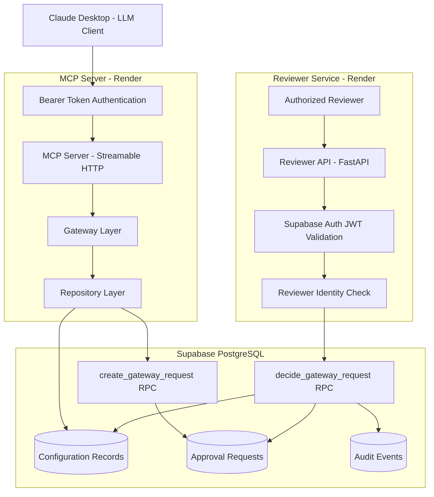
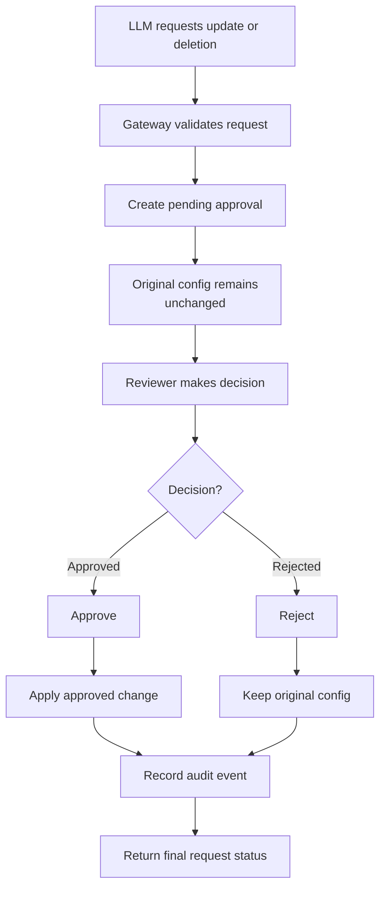

# Secure MCP Gateway

A secure, approval-driven **Model Context Protocol (MCP) Gateway** built with Python, FastAPI, and Supabase.

The gateway allows LLM clients to access service configuration records while preventing sensitive updates and deletions from executing without explicit human approval.

It combines MCP tool access, reviewer authentication, database-level authorization, transactional approval workflows, and audit logging to demonstrate how AI agents can interact with sensitive systems under controlled permissions.

[GitHub Repository](https://github.com/Kaustubhkongile/secure-mcp-gateway)

---

## Key Features

- **MCP Integration:** Exposes service configuration data through six MCP tools.
- **Controlled Mutations:** Configuration updates and deletions create approval requests instead of executing immediately.
- **Human-in-the-Loop:** Authorized reviewers approve or reject pending operations.
- **Authentication:** Bearer-token authentication protects the remote MCP endpoint.
- **Reviewer Authorization:** Supabase Auth validates reviewer identities, with an additional database-side authorization check.
- **Transactional Operations:** Approved changes are applied through PostgreSQL RPC functions.
- **Audit Logging:** Records request creation, approval, and rejection events.
- **Duplicate Decision Protection:** Prevents already-processed requests from being decided again.
- **Input Validation:** Restricts supported operations and validates request payloads.
- **Automated Testing:** 136 passing tests with 98% code coverage.


## Architecture

The gateway separates LLM-facing operations from reviewer decision-making. Sensitive configuration changes require explicit reviewer authorization before execution.

### System Architecture



### Approval Workflow



### Request Lifecycle

1. An LLM client requests a configuration update or deletion through an MCP tool.
2. The gateway validates the requested operation and creates a pending approval request.
3. The original configuration remains unchanged.
4. An authorized reviewer authenticates with Supabase and submits an approval or rejection decision.
5. The reviewer API invokes the PostgreSQL `decide_gateway_request` RPC.
6. The database function verifies authorization and processes the pending request.
7. Approved changes are applied and audit events are recorded. Rejected requests leave the original configuration unchanged.

**Important:** The MCP server does not expose a direct approval tool. Approval decisions are handled separately by the authenticated reviewer API.

## Tech Stack

| Technology | Purpose |
|---|---|
| Python 3.11+ | Backend implementation |
| MCP Python SDK | MCP server and tool integration |
| FastAPI | Reviewer API |
| Supabase Auth | Reviewer authentication |
| PostgreSQL | Configuration and approval persistence |
| PostgreSQL RPC | Transactional approval workflow |
| Pydantic | Request validation |
| pytest | Automated testing |
| pytest-cov | Code coverage |
| Render | Remote deployment |

## Project Structure

```text
secure-mcp-gateway/
│
├── app/
│   ├── __init__.py
│   ├── gateway.py
│   ├── mcp_auth.py
│   ├── repository.py
│   ├── reviewer_api.py
│   ├── server.py
│   └── supabase_client.py
│
├── scripts/
│   ├── test_approval_rpc.py
│   ├── test_gateway_supabase.py
│   ├── test_request_rpc.py
│   ├── test_reviewer_login.py
│   └── test_supabase.py
│
├── tests/
│   ├── test_gateway.py
│   ├── test_mcp_auth.py
│   ├── test_repository.py
│   ├── test_reviewer_api.py
│   └── test_server.py
│
├── .env.example
├── .gitignore
├── pyproject.toml
└── README.md
```

## Live Deployment

The project is deployed as two separate Render services backed by Supabase.

| Component | Endpoint |
|---|---|
| Remote MCP Server | https://secure-mcp-gateway.onrender.com |
| MCP Streamable HTTP Endpoint | https://secure-mcp-gateway.onrender.com/mcp |
| MCP Health Check | https://secure-mcp-gateway.onrender.com/health |
| Reviewer API | https://secure-mcp-gateway-reviewer.onrender.com |
| Reviewer Health Check | https://secure-mcp-gateway-reviewer.onrender.com/health |
| Reviewer Decision API | `POST /decisions` on the Reviewer API |

The remote MCP endpoint requires a valid bearer token. The reviewer API separately validates Supabase Auth access tokens and reviewer permissions.
## Live Deployment

The project is deployed as two separate Render services backed by Supabase.

| Component | Endpoint |
|---|---|
| Remote MCP Server | `https://secure-mcp-gateway.onrender.com` |
| MCP Streamable HTTP Endpoint | `https://secure-mcp-gateway.onrender.com/mcp` |
| MCP Server Health | [Check MCP Server](https://secure-mcp-gateway.onrender.com/health) |
| Reviewer API | `https://secure-mcp-gateway-reviewer.onrender.com` |
| Reviewer API Health | [Check Reviewer API](https://secure-mcp-gateway-reviewer.onrender.com/health) |
| Reviewer Decision API | `POST /decisions` on the Reviewer API |

### Deployment Notes

- The remote MCP endpoint uses bearer-token authentication.
- The reviewer API separately validates Supabase Auth access tokens and reviewer permissions.
- Both services expose health-check endpoints to verify service availability.
- The services use Render's free tier, so cold starts or temporary unavailability may occur.
**Deployment note:** The services use Render's free tier, so cold starts or temporary unavailability may occur.

## Available MCP Tools

The MCP server exposes six tools:

| Tool | Description |
|---|---|
| `list_records` | Lists available service configuration records. |
| `get_record` | Retrieves an individual configuration record. |
| `request_record_update` | Creates a configuration update request requiring approval. |
| `request_record_deletion` | Creates a deletion request requiring approval. |
| `get_approval_status` | Retrieves the current status of an approval request. |
| `get_audit_log` | Retrieves recorded audit events. |

Update and deletion operations never directly modify the target record through the MCP tools.

## Local Development Setup

### Prerequisites

- Python 3.11 or newer
- Git
- A Supabase project
- PowerShell or another terminal

### 1. Clone the repository

```bash
git clone https://github.com/Kaustubhkongile/secure-mcp-gateway.git

cd secure-mcp-gateway
```

### 2. Create a virtual environment

Windows PowerShell:

```powershell
python -m venv .venv

.\.venv\Scripts\Activate.ps1
```

### 3. Install dependencies

```powershell
python -m pip install -e ".[dev]"
```

### 4. Configure environment variables

Create your local environment file:

```powershell
Copy-Item .env.example .env
```

Configure the following variables:

| Variable | Purpose |
|---|---|
| `SUPABASE_URL` | Supabase project URL |
| `SUPABASE_KEY` | Server-side key used by the repository |
| `SUPABASE_ANON_KEY` | Key used for reviewer authentication |
| `REVIEWER_USER_ID` | Supabase Auth UUID of the authorized reviewer |

For remote MCP deployment, also configure:

| Variable | Purpose |
|---|---|
| `MCP_TRANSPORT` | Set to `streamable-http` for remote transport |
| `MCP_AUTH_TOKEN` | Shared secret required to access the remote MCP endpoint |

Keep credentials and access tokens in environment variables. Never commit `.env` or production secrets.

### 5. Configure Supabase

Provision the database schema, permissions, and PostgreSQL functions required by the application.

The implementation uses:

**Database tables**
- `config_records`
- `approval_requests`
- `audit_events`

**Authorization-related table**
- `private.gateway_reviewers`

**PostgreSQL RPC functions**
- `create_gateway_request`
- `decide_gateway_request`

The database functions are responsible for request creation and reviewer decision processing.

Ensure the required database permissions and reviewer authorization rules are configured before running integration workflows.

## Running Locally

### Run the MCP Server

With the virtual environment activated:

```powershell
python -m app.server
```

The default local transport is STDIO, suitable for MCP clients such as Claude Desktop.

### Run the Reviewer API

Open a separate terminal:

```powershell
.\.venv\Scripts\Activate.ps1

python -m uvicorn app.reviewer_api:app --host 127.0.0.1 --port 8000
```

Health endpoint:

```text
http://127.0.0.1:8000/health
```

Reviewer decision endpoint:

```text
POST http://127.0.0.1:8000/decisions
```

Example request:

```json
{
  "request_id": "your-pending-request-id",
  "approve": true
}
```

The endpoint requires a valid Supabase Auth access token:

```text
Authorization: Bearer <supabase-access-token>
```

Set `approve` to `false` to reject a request.

Only the configured reviewer is authorized to make decisions.

## Remote MCP Transport

The application supports two MCP transports:

| Transport | Use case |
|---|---|
| STDIO | Local MCP clients |
| Streamable HTTP | Remote MCP clients |

For remote deployment, configure:

```text
MCP_TRANSPORT=streamable-http
MCP_AUTH_TOKEN=<your-secret-token>
```

The remote endpoint is:

```text
https://secure-mcp-gateway.onrender.com/mcp
```

The MCP endpoint uses bearer-token authentication. The reviewer API uses a separate Supabase Auth JWT and reviewer identity validation.

This separation ensures that access to MCP tools does not automatically grant permission to approve sensitive operations.

## Testing

Run the automated test suite:

```powershell
python -m pytest -q
```

Run tests with coverage:

```powershell
python -m pytest --cov=app --cov-report=term-missing
```

### Verified Test Results

Latest verified test execution:

| Metric | Result |
|---|---:|
| Total tests | 136 |
| Passed | 136 |
| Failed | 0 |
| Total statements | 344 |
| Uncovered statements | 7 |
| Overall coverage | **98%** |
| Execution time | 5.14 seconds |

### Module-wise Coverage

| Module | Coverage |
|---|---:|
| `gateway.py` | 99% |
| `mcp_auth.py` | 100% |
| `repository.py` | 100% |
| `reviewer_api.py` | 98% |
| `server.py` | 96% |
| `supabase_client.py` | 92% |

### Manual Security Validation

The following six security checks were also verified against the deployed services:

| Security Scenario | Expected Response | Result |
|---|---:|---|
| Missing reviewer authentication | 401 | Passed |
| Invalid reviewer JWT | 401 | Passed |
| Authenticated non-reviewer | 403 | Passed |
| Invalid reviewer request payload | 422 | Passed |
| Missing MCP bearer token | 401 | Passed |
| Invalid MCP bearer token | 401 | Passed |

Additional integration testing verified successful approval and rejection workflows, configuration persistence, and audit events.

The scripts in `scripts/` support additional Supabase integration testing. Run them only against a dedicated development or test project because they may interact with persistent data.

## Security Design

### 1. MCP Authentication

The remote MCP endpoint is protected by bearer-token authentication.

The middleware validates the supplied token before allowing access to the MCP endpoint.

### 2. Reviewer Authentication

Supabase Auth validates reviewer access tokens.

### 3. Reviewer Authorization

The reviewer API verifies the authenticated user's identity against the configured reviewer ID. The database decision function independently enforces reviewer authorization.

### 4. Human-in-the-Loop Approval

Sensitive update and deletion operations remain pending until an authorized reviewer makes a decision.

### 5. Transactional Decision Processing

The PostgreSQL RPC function handles approval decisions, approved configuration changes, and corresponding audit events.

### 6. Duplicate Decision Protection

Requests that have already been processed cannot be approved or rejected again.

### 7. Audit Logging

The application records request creation and reviewer decisions, providing an audit trail of sensitive operations.

### 8. Secret Management

Environment variables are used for credentials and deployment secrets. The `.gitignore` configuration excludes local environment files.

## Limitations and Production Readiness

This project is a portfolio and development demonstration of secure MCP tool access and human-reviewed operations.

Before using it to manage production systems, additional engineering and security reviews should cover:

- Database grants, Row Level Security policies, and RPC function ownership.
- Reviewer onboarding, revocation, and multi-reviewer authorization.
- API rate limiting and abuse protection.
- Audit-log retention and tamper resistance.
- Concurrency handling and operational recovery.
- Monitoring, alerting, and observability.
- Secret rotation and deployment security.
- Comprehensive integration testing against a dedicated test database.

Passing automated tests and manual security checks does not independently establish production readiness.

## Author

**Kaustubh Kongile**

GitHub: [Kaustubhkongile](https://github.com/Kaustubhkongile)

---

If you find this project useful, feel free to explore the repository and its implementation.